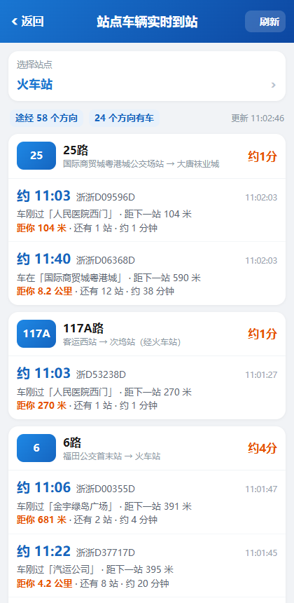

# 诸暨实时公交 · 增强版

> 给诸暨人（尤其是老人）用的**免登录**实时公交查询页。打开就能查，不用浙里办、不用支付宝、不用注册。
>
> 本仓库基于 [byazlle/zhuji-bus-live](https://github.com/byazlle/zhuji-bus-live) 二次开发，**完整保留原项目功能**，新增「站点车辆实时到站」和「路线规划 & 换乘方案」。

**在线使用：<https://0124577.github.io/zhuji-bus-live-enhanced/>**

**源码仓库：<https://github.com/0124577/zhuji-bus-live-enhanced>**

**安卓安装包：[下载 APK](https://github.com/0124577/zhuji-bus-live-enhanced/releases/latest)**（Android 5.0+，装完点开即用）

<p align="center">
  
  
  
</p>
<p align="center">
  
  
  
</p>

---

## 为什么做这个

诸暨公交只能在"浙里办"里查，老人没有支付宝、也不会登录，出门前想知道"下一班还有几分钟"非常麻烦。

这个页面做的事很简单：**直连诸暨市公交的公开数据接口，不需要任何登录，输入线路号就能看到下一班车还有几分钟到你要坐的那一站。**

## 功能

| 功能 | 说明 |
|---|---|
| 免登录 | 直接调诸暨公交官方接口，无需账号 |
| 线路搜索 | 内置 395 条线路（含城乡公交、夜间专线），输入 `1`、`105A` 即可 |
| 常用线路 | 收藏上限 30 条，存在本机；`管理` 可批量删除 |
| 方向切换 | 不用"上行/下行"，直接写「发车 起点站 / 终点 终点站」 |
| 站点排序 | 「终点站在上 / 起点站在上」一键切换，偏好会记住 |
| 我在哪一站 | 进线路页**自动定位**并滚动到所在站，也可点站点手动选 |
| 车辆信息 | 车现在到哪一站、还有几站到你这、大约几分钟 |
| 只显示没开过的车 | 已经过站的车自动隐藏；最近的那辆标「最近」 |
| 分级自动刷新 | 1 站内 10 秒、2 站 15 秒、3 站以上 60 秒；切后台自动暂停 |
| 发车表 | 点开就是**完整发车时刻表**：两个方向各自的官方全天班次（共几班、已发几班，已过灰显、下一班高亮），外加首班 / 末班 / 全程公里 / 站数 / 票价 / 到你这站约几分钟 |
| 没车也有答案 | 车刚开过或线路上暂时没车时，直接显示「下一班 X:XX 发车，约 X:XX 到你这一站」，不再只写「等下一班」 |
| 方向箭头 | 站点列表背景有一枚很淡的箭头，始终指向终点（起点在上朝下、起点在下朝上），随排序切换 |
| 字号调节 | 90% ~ 136% 五档，老人看得清；布局不散 |
| 安卓 APK | 单文件 WebView 壳，装完点开就用（[下载](https://github.com/0124577/zhuji-bus-live-enhanced/releases/latest) / `dist/` 内也有） |
| **站点车辆实时到站** | 选 1 个站点，批量展示所有途经线路的车辆：到站时间、距你距离、车辆所在站、距下一站距离、GPS 时间；60 秒自动刷新 |
| **路线规划 & 换乘方案** | 选起点 / 终点，自动规划直达或换乘方案；支持多个方案切换，展示每段线路、上下车点、换乘点、总耗时和预计到达时间 |
| **统一站点选择组件** | 线路树形展开（按线路 → 方向 → 站点）+ 中文站名模糊搜索，两个新功能共用 |

## 界面

- 大字大按钮、高对比度，**站点列表 18px、车辆时间 19px**
- 车辆卡片吸顶，滚动看站点时一直能看到"下一班还有几分钟"
- 车辆卡片吸顶区约占屏幕 25%，尽量把空间留给站点列表

## 技术说明

- **纯静态单文件**：`index.html` 内联了全部 CSS/JS/线路数据/站点索引快照，无框架、无构建、无外部依赖，双击即可打开
- **接口直连**：`POST https://zjcx.zhuji.gov.cn:9443`，`Content-Type: application/json`
  - 该接口返回 `Access-Control-Allow-Origin: *`，所以浏览器和 WebView 都能直接跨域调用，**不需要自建后端代理**
  - 请求体结构 `{ "h": {固定请求头}, "b": {业务参数} }`，详见 [docs/API-接口文档.md](docs/API-接口文档.md)
- **本地存储**：收藏、上次选站、字号、站点排序都存 `localStorage`，不上传任何数据
- **定位**：调用浏览器 `navigator.geolocation`，坐标只在本地换算"最近站点"，**不上传、不记录**
- **兼容性**：Android 5.0+ WebView / 微信内置浏览器 / Chrome / Safari；无 `fetch` 的老内核自动降级到 `XMLHttpRequest`
- **站点索引快照**：395 条线路的 779 个方向、3061 个站点已压缩内联（约 693 KB），来自原有 `queryLine` 接口；由 `scripts/generate-station-index.py` 生成，无需后端、无需运行时重复抓线路详情
- **规划算法**：直达优先 → 1 次换乘 → 2 次换乘；按站间距离 / 240 米每分钟 + 每站 0.35 分钟停站估算，同站换乘预留 5 分钟

### 关键实现点（踩过的坑）

1. `vehicleOrder` 是**车已经开过的那一站**（1 起），不是"下一站"；`distance` 是到**下一站**的米数。
   所以 `还有几站 = 我的站序 − vehicleOrder`，等于 0 且已走远就判定为"刚开走"并隐藏。
2. 方向卡片不画箭头，直接写清「发车 / 终点」；行驶方向改用列表背景的淡箭头表达（起点在上朝下、起点在下朝上）。
3. `startTime`（车辆接口返回）是官方给的**下一班发车时间**，线路收班或无车时为空；用它就能在"没车可显示"时给出准确发车时刻。
   **完整的全天时刻表**在 `busLine/getBusLinePlanSimpleTime`（传 `lineId`，返回 `["06:20","06:45",...]`），这条接口不在官方文档里，是从参考开源项目里挖出来的。部分线路返回空数组，需兜底。
4. 到站时间 = `下一班发车时刻 + 起点到该站的累计里程 ÷ 平均车速(240 米/分) + 每站 0.35 分钟停站`；`lastDistance` 是「到上一站」的距离，要自己累加，不是累计里程。
5. 吸顶不要写死 `top: 105px`，把「顶栏 + 方向 + 我在哪站 + 车辆卡片」放进**同一个 sticky 容器**（`top: 0`）才不会遮挡。
6. `body { overflow-x: hidden }` 会让 body 变成滚动容器，直接破坏 `position: sticky` 和整页滚动，别加。
7. 字号缩放用 `zoom`（布局级缩放，文字重新栅格化，清晰），不要用 `transform: scale`（会糊）。
8. 自动定位滚动要避开吸顶：用 `sticky.getBoundingClientRect().height` 当偏移量自己算 `scrollTo`，别用 `scrollIntoView`。
9. `station/details` 接口会漏报车辆（实测热门站点漏 2~6 个方向），所以「站点车辆实时到站」直接并发调用原有的 `line/details` 接口，不拿预筛结果当唯一依据。
10. 换乘规划用「站点名 → (方向, 站序)」索引反查可达终点，再按换乘次数分层搜索；同名站点视为同一换乘点。

## 目录结构

```
.
├── index.html                 # 在线页面（GitHub Pages 入口，与 web/index.html 同源）
├── web/index.html             # 开发源文件
├── android/                   # 安卓 WebView 壳（手写工程，不依赖 Gradle）
│   ├── src/com/zjbus/live/MainActivity.java
│   ├── res/                   # 图标与主题
│   ├── AndroidManifest.xml
│   ├── build.sh               # 一条命令出 APK
│   └── make_icons.py          # 纯 Python 生成启动图标
├── dist/诸暨实时公交.apk       # 已签名安装包（增强版 v1.1.1）
├── docs/
│   ├── API-接口文档.md         # 接口字段、实测结论
│   ├── 项目说明与迭代记录.md    # 需求、修复清单、迭代历史
│   └── 二次开发自测报告.md      # 新功能与边界测试结果
├── assets/                    # 首页 / 详情 / 发车表 / 新增功能截图
├── scripts/
│   ├── sync-web.sh            # 把 web/index.html 同步到根目录
│   └── generate-station-index.py # 从官方接口重建站点快照并内联
└── tests/e2e/                 # Puppeteer 浏览器自测脚本
```

## 本地运行

```bash
# 方式一：直接双击 index.html（file:// 也能正常调接口）

# 方式二：起个本地服务
cd web && python -m http.server 8080
# 浏览器打开 http://127.0.0.1:8080
```

修改页面请改 **`web/index.html`**，然后同步到根目录：

```bash
bash scripts/sync-web.sh
```

新功能入口在首页搜索框下方：
- **站点车辆实时到站**：选站点 → 批量查看所有途经车辆的实时到站信息
- **路线规划&换乘方案**：选起点、终点 → 直达 / 换乘方案自动切换

### 重建站点索引快照

仅当官方新增大量线路或需要刷新站名时执行（需要 Python 3 + 网络）：

```bash
python scripts/generate-station-index.py
bash scripts/sync-web.sh
```

脚本会调用原有的 `queryLine` 接口抓取全部线路，压缩后写回 `web/index.html` 的 `STATION_SNAPSHOT` 区块。

## 网页部署

### GitHub Pages

1. Fork / 使用本仓库，进入 `Settings → Pages`
2. Source 选择 `Deploy from a branch`，分支 `main`、目录 `/ (root)`
3. 保存后访问 <https://0124577.github.io/zhuji-bus-live-enhanced/>

根目录下 `index.html` 与 `web/index.html` 内容一致，无需构建步骤。也可直接把整个根目录上传到任意静态托管服务（Netlify、Vercel、OSS 静态网站等）。

### 环境依赖

| 场景 | 依赖 |
|---|---|
| 直接打开 / 网页部署 | 支持 ES2020 的现代浏览器，无框架、无后端 |
| 本地预览 | Python 3（或任意静态文件服务器） |
| 重建站点快照 | Python 3 + 可访问 `zjcx.zhuji.gov.cn:9443` |
| APK 打包 | JDK 17 + Android SDK（build-tools 34.0.0、platform android-34） |
| 浏览器自测 | Node.js 18+ + Chrome / Edge + `puppeteer-core` |

## 打包安卓 APK

工程是**手写的最小 WebView 壳**，不依赖 Android Studio / Gradle。增强版 APK 版本码为 2、版本名 1.1.1。

```bash
# 1) 准备 Android SDK（若还没有）
#    下载 Android commandline-tools，解压到 $ANDROID_HOME/cmdline-tools/latest
sdkmanager --sdk_root="$ANDROID_HOME" "platforms;android-34" "build-tools;34.0.0"
yes | sdkmanager --sdk_root="$ANDROID_HOME" --licenses

# 2) 构建
export JAVA_HOME=/path/to/jdk-17
export ANDROID_HOME=/path/to/android-sdk
bash android/build.sh
# 产物：dist/诸暨实时公交.apk
```

Windows（Git Bash）示例：

```bash
export JAVA_HOME="/c/Program Files/Eclipse Adoptium/jdk-17.0.21.9-hotspot"
export ANDROID_HOME="/c/work/_tools/sdk"
bash android/build.sh
```

构建流程：`aapt2 compile/link → javac → d8 → 打包 classes.dex → zipalign → apksigner`。  
脚本会自动把 `web/index.html` 复制进 APK 的 `assets/www/index.html`，所以网页新增功能会同步进入安装包。

首次构建会在 `android/` 下生成自签名证书 `release.keystore`（已加入 .gitignore，请自行备份；升级覆盖安装必须使用同一份证书）。

APK 权限只有：网络、网络状态、定位（点「定位」时才会申请）。

## 自测

浏览器自动化脚本位于 `tests/e2e/`，覆盖原功能回归、站点选择、实时到站、直达/换乘、网络异常等场景。完整结果见 [docs/二次开发自测报告.md](docs/二次开发自测报告.md)。

```bash
cd web && python -m http.server 8080
cd ../tests/e2e
npm install
npm run test:all
```

## 数据来源与免责声明

- 数据来自诸暨市公交官方查询服务（`zjcx.zhuji.gov.cn`），本站只做展示
- 车辆位置为车载 GPS 上报，存在几十米误差与 10~30 秒延迟
- 首末班时间、票价来自官方接口，**班次间隔以站牌和现场为准**
- 本项目为个人自用工具，与诸暨市公交公司无隶属关系；如官方接口调整，功能可能失效

## License

[MIT](LICENSE)
